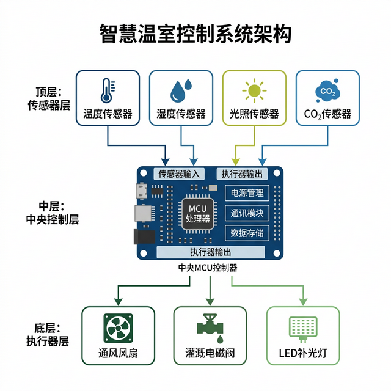
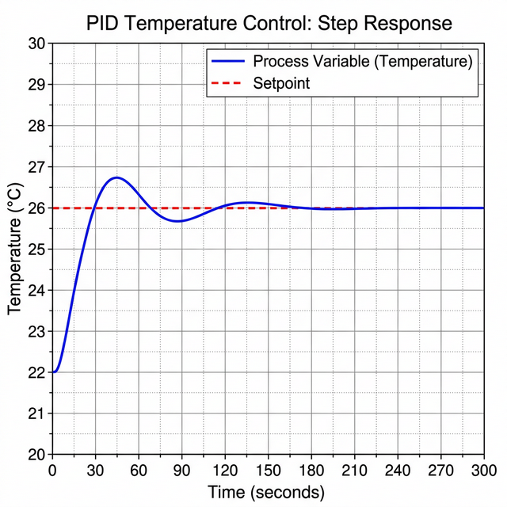

修改时间：2026年10月20日

## 1. 概述

### 1.1 项目背景

本方案设计一套温室环境控制系统，采集温度、湿度、光照和CO₂浓度，根据设定值控制通风、灌溉及补光设备，并记录运行数据。控制目标、接口分工和验证方法分别在第2章、第3章和第4章说明。

方案中的控制参数与响应曲线用于设计演示，实际部署前需完成设备标定和参数整定。本报告同时作为Markdown转Word的示例，主要功能及对应位置见第5章。

### 1.2 设计目标

温度测量误差目标为±0.5°C，湿度测量误差目标为±3%RH；从检测到偏差到执行调节动作的时间不超过30秒。系统按7×24小时连续运行设计，相关指标作为后续验证的判据，不代表已取得的实测结果。

表1-1 设计输入与目标

| 参数 | 设计值 | 说明 |
| -------- | ------------------ | -------------------------------------------- |
| 温室面积 | 10~20m² | 用于方案验证的小型温室 |
| 目标温度 | 25°C | 实际设定值按作物和生长阶段调整 |
| 温度误差 | ±0.5°C | 温度测量通道的目标误差 |
| 采样周期 | 2秒 | 传感器数据采集和控制计算的设计周期 |

## 2. 系统架构与控制算法

### 2.1 硬件组成

系统分为感知、控制和执行三层。感知层采集环境参数，控制层完成数据校验与控制计算，执行层驱动风机、电磁阀和补光灯。数据和控制指令的关系见图2-1，各层组件见表2-1。



图2-1 智能温室控制系统三层架构示意图

表2-1 各层核心组件及功能

| 层级 | 核心组件 | 功能描述 |
| -------- | ---------------------------- | ------------------------------------ |
| 感知层 | 温湿度、光照、CO₂传感器 | 采集环境数据并报告测量状态 |
| 控制层 | 主控MCU、通信及存储模块 | 校验输入数据、计算控制量并保存记录 |
| 执行层 | 风机、电磁阀、LED补光灯 | 执行通风、灌溉和补光指令 |

### 2.2 温度控制算法

以$e(k)$表示第$k$个采样周期的温度偏差，$K_p$、$K_i$和$K_d$分别表示离散控制器的比例、积分与微分系数。定义$\Delta e(k)=e(k)-e(k-1)$，增量式PID控制量为：

$$
\Delta u(k)=K_p\Delta e(k)+K_i e(k)+K_d[\Delta e(k)-\Delta e(k-1)]\tag{2-1}
$$

由式(2-1)计算增量后，叠加到上一周期输出，并执行上下限约束。此处的$K_i$和$K_d$已包含采样周期的影响，整定时不应重复乘除采样周期。参数使用和调整记录按参考文献[1]保存。

在工作点附近，用一阶惯性加纯滞后模型描述温度调节对象：

$$
G(s)=\frac{K}{Ts+1}e^{-\tau s}\tag{2-2}
$$

其中$K$为静态增益，$T$为时间常数，$\tau$为纯滞后时间。式(2-2)保留分式结构；实际对象参数应从阶跃试验中辨识。图2-2给出用于演示的温度响应曲线，曲线形状不作为实际系统性能结论。



图2-2 PID温度控制阶跃响应曲线

### 2.3 符号与公式表达

简单行内符号如$x_i$、$x^2$和$K_p$可用普通文字及上下标表达。含嵌套结构的$x_{\frac{a}{b}}$、根式$\sqrt{a^2+b^2}$和分式$\frac{a+b}{c}$应保留为可编辑公式。

同一公式内的$m_{static}$和$\Delta m_{trunc}$用于检查连续数学字符的排版，$a\qquad b$用于检查公式空格。普通文本中的CO₂、m²及10⁻⁵直接使用Unicode字符，不额外创建公式对象。

## 3. 软件与通信设计

### 3.1 模块分工

嵌入式固件负责数据采集、控制计算和执行保护；上位机负责显示、配置及历史查询。模块之间传递带时间戳和质量标识的数据，通信失败时保留告警记录。软件分工见表3-1，温度控制逻辑对应第2.2节。

表3-1 软件模块与开发工具

| 模块 | 语言或工具 | 功能描述 |
| ---------- | ------------------ | -------------------------------------------- |
| 嵌入式固件 | C / Keil | 采集传感器数据，执行PID计算及输出限幅 |
| 上位机界面 | Python / Qt | 显示实时数据，配置设定值及报警阈值 |
| 数据服务 | Python / SQLite | 存储运行记录，支持历史查询与报表导出 |

### 3.2 接口定义

内部总线拟采用RS-485，应用层采用Modbus RTU，串口设置为9600bps、8N1。接口定义与超时策略需在联调前确认，候选配置见表3-2。远程监控接口与本地控制循环分开，远程通信中断不影响本地保护逻辑。

表3-2 通信字段与异常处理

| 字段 | 标识符 | 处理要求 |
| -------- | ------------------------ | -------------------------------------------- |
| 温度数据 | MON_TEMP_A | 附带采样时间和有效标识，异常值不直接进入控制计算 |
| 湿度数据 | MON_HUMIDITY_A | 连续超限时记录告警，并由上位机显示传感器状态 |
| 控制状态 | CTRL_STATUS | 保留当前模式、输出限幅及通信异常等状态，供联调检查 |

### 3.3 配置记录

配置文件与记录路径保留原有空格和引号，避免在文档转换时改变配置含义。下面的代码片段同时检查中文、路径、数组下标和单位字符串的保留情况。

```python
site_name = "温室 A"
log_path = r"C:\Greenhouse Demo\logs"
sensor_note = "保留  两个空格"
unit_text = "5 mm"
first_sample = samples[1]
```

## 4. 验证方案

### 4.1 验证步骤

1. 分别标定温度、湿度、光照和CO₂测量通道，记录测量值、参考值及环境条件。
2. 在小型温室开展连续运行试验，检查采样、控制、数据记录及断线恢复过程，验证第3章的接口约定。
3. 按相同工况比较调整前后的控制响应，保留原始数据、参数版本和计算结果，判据采用表1-1。

### 4.2 误差评价

定义$e_i$为第$i$个有效样本的温度误差，$N$为有效样本数。均方根误差采用式(4-1)计算，只有质量标识有效的样本参与统计。

$$
E_{rms}=\sqrt{\frac{1}{N}\sum_{i=1}^{N}e_i^2}\tag{4-1}
$$

该误差计算式同时包含根式、分式和求和结构，转为Word后应保留其可编辑性。试验数据的有效范围与异常样本剔除规则按参考文献[1,2]记录，不在获得结果后临时调整判据。

表4-1 验证项目与依据

| 项目 | 依据 | 核查内容 |
| -------- | -------------------- | -------------------------------------------- |
| 温度闭环 | 第2.2节、式(2-1) | 核对采样周期、控制系数和输出限幅 |
| 响应曲线 | 图2-2、式(2-2) | 对照模型与曲线，检查参数和工况记录 |
| 误差统计 | 式(4-1)、表1-1 | 使用有效样本计算误差，并与设计目标比较 |

## 5. 文档功能核对

主要文档功能的检查位置见表5-1。图、表、公式和章节引用应能随Word域更新，文献引用应整体上标，参考文献条目本身保持普通字号。配置代码中的方括号数字保持代码格式。

表5-1 文档主要功能及检查位置

| 功能 | 检查位置 | 预期结果 |
| ---------- | ------------------------ | -------------------------------------- |
| 封面与标题 | 封面、第1章至第6章 | 显示报告标题和当前年月，章节不重复编号 |
| 图表题注 | 图2-1、图2-2、表3-2 | 编号显示完整，图片居中，题注独立成段 |
| 表格列宽 | 表1-1、表3-2 | 短字段易读，长说明可换行，总宽不超正文页宽 |
| 公式排版 | 第2.2节、第2.3节、式(4-1) | 简单上下标正确，复杂结构和显示公式保留 |
| 交叉引用 | 第2章、第4章、表4-1 | 图表、公式及章节引用生成可更新的域 |
| 文献与代码 | 第3.3节、第4.2节 | 正文文献引用上标，代码字符和空格保留 |

## 6. 参考文献

[1] 智能温室项目组．温度控制参数整定记录．项目内部配套记录。

[2] 智能温室项目组．环境测量通道标定与试验记录．项目内部配套记录。
